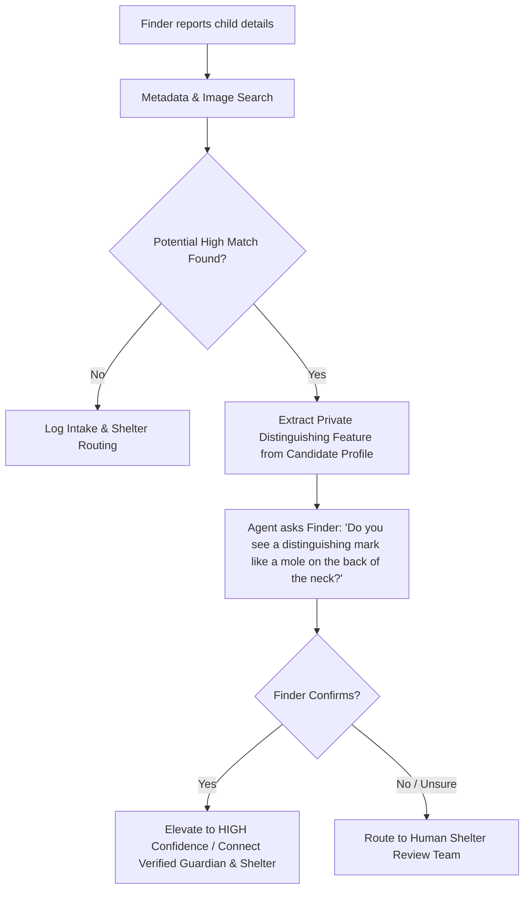
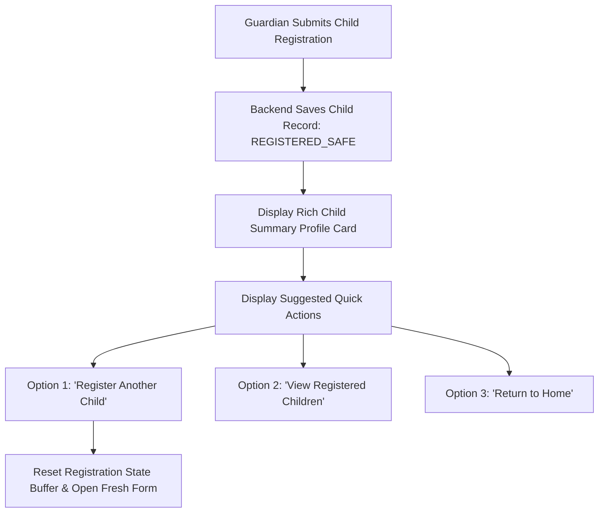
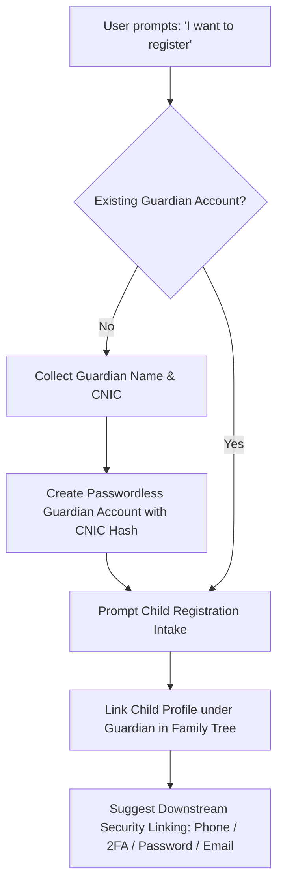
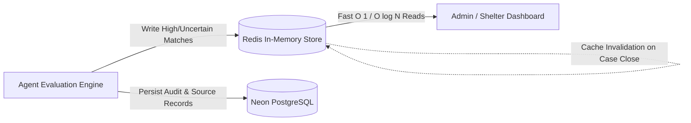

# Wayfind: Feature Backlog & Enhancement Proposals

This document outlines proposed enhancements for the **Found Child** reporting flow, **Agent Match Verification**, **Child Pre-Registration & Multi-Child Experience**, **Guardian Account Onboarding & Family Tree Architecture**, **Redis Caching for Active Missing Cases**, and **Conversational Intake & Guardian Portal UI Redesign**.

---

## 1. Estimated Age Range for Found Children

### Problem Statement
When a user finds an unaccompanied child, they rarely know the child's exact age. Forcing or asking for a single exact integer creates friction and false precision (e.g., guessing 6 when the child is 5 or 7).

### Proposed Solutions & UX

1. **Age Range Inputs in Form Card:**
   - Modify `InlineFormCard.tsx` to support range selection (e.g., min age & max age, preset range chips like `1–3 yrs (Toddler)`, `4–6 yrs (Young child)`, `7–10 yrs (School age)`, `11–14 yrs (Pre-teen)`).
   - Provide a dual slider or two quick dropdowns/inputs (`Min Age` – `Max Age`).

2. **Schema & Backend Support:**
   - In `schemas/child.py`, ensure `FoundChildReport.approx_age` accepts `AgeRange(min=..., max=...)`.
   - Update SQL & vector filtering to use overlapping age interval matching:
     $$\text{Candidate.age} \in [\text{Report.age.min} - 1, \text{Report.age.max} + 1]$$

3. **Prompt & Extraction Handling:**
   - Update `extract_structured_data.py` and `_FoundChildLLM` to extract `approx_age_min` and `approx_age_max` when users say natural phrases like *"looks around 4 or 5"* or *"between 6 to 8 years old"*.

---

## 2. Multi-Feature Distinguishing Marks & Interactive Match Verification

### Problem Statement
Physical descriptions (e.g. hair color, gender, general clothing) often yield multiple candidate matches. Connecting a finder directly to parents based on loose similarity risks distress, security hazards, and false matches.

### Proposed Workflow: Challenge-Response Verification Question



### Key Components

1. **Multi-Feature Entry:**
   - Allow reporting users to enter multiple tags/descriptors for `distinguishing_features` (e.g., `["mole on back of neck", "scar on left forearm", "silver bracelet"]`).

2. **Targeted Verification Node (`verify_candidate_feature`):**
   - When `search_child_records` identifies candidate cases with high similarity, inspect unrevealed distinguishing features in the candidate profile.
   - The LLM dynamically crafts a discreet verification question to the finder without revealing sensitive parent/guardian PII.
   - Example prompt:
     > *"To help us confirm a potential match in our registry: Does the child have a small mole or birthmark near the back of their neck or shoulder?"*

3. **Safe Guardian Connection:**
   - **Affirmative Response:** Immediately escalate confidence tier to `HIGH` and initiate authorized contact procedure (or notify the registered parent with shelter coordination).
   - **Negative / Unknown Response:** Escalate to `UNCERTAIN` for shelter caseworker review; do not share contact details.

---

## 3. Child Pre-Registration UX & Multi-Child Handling

### Current State (What happens right now)
- **Static Confirmation Only:** When a child is registered, the assistant emits a raw text message containing the registration reference ID.
- **Session Reuse Blindness:** If a session is retained or if the user clicks "I want to register my child" again in the same active conversation, the backend retains the existing `child_registration_data` object in state. Because the completeness check sees that all required fields are already satisfied for that previous child, it immediately re-registers or prints the previous confirmation without asking for new child details or offering a choice.
- **No Direct Follow-Up Actions:** The user is left at a dead end after registration with no clear buttons to register another sibling, review active profiles, or safely exit.

### Desired Change (Proposed Solution)



1. **Rich Child Profile Summary Card:**
   - Render a structured, clean profile summary card in the chat:
     - **Full Name:** e.g., *Syed Muhammad Anser*
     - **Age & Gender:** e.g., *7 years old · Male*
     - **Home City / Area:** e.g., *Lahore / DHA Phase 5*
     - **Status Badge:** `● REGISTERED_SAFE`
     - **Registration ID:** `WF-REG-CDB9B0BB` (with one-click Copy button)

2. **Multi-Child Registration Action Buttons:**
   - Render interactive quick-action buttons below the registration card:
     - ➕ **"Register Another Child"**: Flushes the active `child_registration_data` buffer in state and presents a fresh intake form for the next child/sibling under the same guardian account.
     - 📋 **"View Registered Children"**: Opens the drawer showing all children registered by this guardian.
     - 🏠 **"Done / Back to Home"**: Cleans up session and returns to landing page.

3. **Re-Registration Awareness & Confirmation Turn:**
   - If a guardian says *"I want to register my child"* when a registered child is already present in the active session:
     - The assistant detects the prior registration and responds:
       > *"You have already registered **Syed Muhammad Anser** (Registration ID: `WF-REG-CDB9B0BB`). Would you like to register another child?"*
     - Displays two prompt choices: `[Yes, Register Another Child]` and `[No, Keep Current Details]`.

---

## 4. Guardian Account Onboarding, CNIC-Based Identity & Family Tree Architecture

### Current State
- Currently, a child profile is registered directly as a standalone record without an upfront parent/guardian account onboarding step.
- No unified guardian profile or family hierarchy links siblings together under an official guardian credential.

### Desired Change (Proposed Architecture & Flow)



### Key Components

1. **CNIC-Based Account Onboarding (Passwordless Intake):**
   - When a user indicates intent to register, first ask for **Guardian / Parent Details**:
     - **Full Legal Name**
     - **CNIC Number** (Computerized National Identity Card, e.g., `42101-1234567-1` or `35201-1234567-1`).
   - The CNIC acts as the primary unique username / identifier for the guardian.
   - **Zero Password Friction:** No initial password is required during emergency/intake onboarding to minimize drop-off.

2. **Progressive Security Upgrades:**
   - After initial account and child registration, the user is gently prompted to harden account security:
     - 📱 Link & Verify Mobile Number (SMS OTP)
     - 📧 Link Verified Email Address
     - 🔐 Set Password or Enable 2FA (TOTP Authenticator App / Passkeys)

3. **Family Tree Hierarchy:**
   - Each guardian account anchors a **Family Tree Graph**:
     - **Primary Guardian** (Anchored by CNIC)
     - **Co-Guardians / Spouses / Relatives** (Linked by secondary CNICs with authorized access)
     - **Registered Children** (Leaves under the guardian root)
   - Enables instant simultaneous alerts and location updates to all verified family members if a child is ever reported lost.

4. **Hash-Map / Hash Index Storage Strategy for $O(1)$ Lookups:**
   - **Privacy & Compliance:** National ID numbers (CNICs) are never stored in raw plaintext. Instead, store a salted cryptographic hash:
     $$\text{cnic\_hash} = \text{HMAC-SHA256}(\text{CNIC}, \text{SECRET\_SALT})$$
   - **Database Indexing:** In PostgreSQL, index the `guardians` table with a **Postgres HASH Index** for constant-time lookups:
     ```sql
     CREATE INDEX IF NOT EXISTS idx_guardians_cnic_hash ON guardians USING HASH (national_id_hash);
     ```
   - **In-Memory Cache ($O(1)$ Hash Map):** In Redis and backend session memory, maintain a hash table `HashMap<CNIC_Hash, GuardianProfile>` to avoid linear scans and allow instant profile verification when a returning guardian enters their CNIC.

---

## 5. Redis In-Memory Cache for Active Missing Cases & Admin Match Queues

### Problem Statement
Repeatedly running multi-table relational queries, spatial PostGIS calculations, and metadata fuzzy filters against the primary Neon PostgreSQL database every time shelter staff or system administrators refresh their dashboards causes high latency and unnecessary database egress costs.

### Proposed Architecture & Redis Data Structures



### Redis Key Design & Operations

1. **Active Missing Cases Cache (`Hash` & `Set`):**
   - **Metadata Hash:** `wayfind:missing:<case_id>`
     - Fields: `name`, `age`, `gender`, `last_seen_location`, `photo_id`, `date_missing`, `guardian_masked_phone`.
     - Provides instant sub-millisecond retrieval of active case profiles.
   - **Active Index Set:** `wayfind:missing:active_ids`
     - Allows quick collection enumeration with `SMEMBERS` or `SCARD` for dashboard counters.

2. **Ranked Candidate Matches (`Sorted Set - ZSET`):**
   - Key: `wayfind:matches:<missing_case_id>`
   - **Member:** `candidate_intake_id` (e.g., `WF-FOUND-9A82B3C1`)
   - **Score:** Composite similarity score (e.g., `0.895`)
   - **Query Pattern:**
     ```bash
     ZREVRANGEBYSCORE wayfind:matches:WF-CASE-001 +inf 0.50 WITHSCORES LIMIT 0 10
     ```
     Enables admins to fetch the top $K$ potential matches ranked by confidence score in $O(\log N)$ time without touching PostgreSQL.

3. **Admin Real-Time Review Queue (`Redis Streams / Lists`):**
   - Key: `wayfind:queue:admin_review`
   - Stores incoming `UNCERTAIN` and `HIGH` confidence match packages ready for immediate caseworker review.
   - Powers real-time admin alerts via Server-Sent Events (SSE) or WebSockets.

4. **Cache Invalidation & TTL Policies:**
   - **Case Resolution:** When a case status transitions to `FOUND` or `RESOLVED`, the backend immediately executes `DEL wayfind:missing:<case_id>` and `ZREMRANGEBYRANK wayfind:matches:<case_id> 0 -1`.
   - **Automatic TTL:** Inactive match candidate caches expire after 30 days (`EXPIRE 2592000`) unless refreshed by new evidence turns.

---

## 6. Humanized Conversational Intake (1-by-1 AI Dialogue & Tap-Chips)

### Current State (What happens right now)
- **All-at-Once Form Dumping:** The assistant immediately triggers an inline form card with all 5–6 fields bundled at once (`Please provide the following details to help us proceed:`), turning the conversational assistant into a rigid web form.
- **Cold Robotic Confirmation Tone:** When completed, it outputs a mechanical status list:
  > `✅ **Child Successfully Pre-Registered on Wayfind** Registration ID: **WF-REG-9A320949** Name: **Anser** Status: **REGISTERED_SAFE**...`
- **Underutilized Chat Bar:** The bottom chat input is largely ignored during intake because the user is forced into form cards rather than natural typing.

### Desired Change (Proposed Conversational Experience)

1. **Warm, Empathetic & Humane Confirmation Tone:**
   - Replace mechanical robotic text with a supportive, reassuring human response:
     > *"Anser is now safely registered with Wayfind. ❤️ We've created their private safety profile under Registration ID **`WF-REG-9A320949`**.*
     > 
     > *This information is securely stored and kept completely confidential. It will only ever be activated if you report an emergency.*
     > 
     > *Would you like to register another child or review your family profile?"*

2. **1-by-1 Conversational Turn Progression:**
   - The AI agent collects information naturally turn-by-turn through conversation:
     - **Turn 1:** *"I'd be glad to help you register your child. What is their full name and approximately how old are they?"*
     - **Turn 2:** *"Thank you. Is Anser a boy or a girl?"*
     - **Turn 3:** *"Which city or neighborhood do you live in?"*
     - **Turn 4:** *"Are there any distinguishing features (like birthmarks or glasses) or medical notes you'd like us to keep on record?"*

3. **Hybrid Chat Interaction (Free-Text Typing + Quick Tap-Chips):**
   - **Full Chat Freedom:** The user can type responses naturally in the bottom input composer (e.g. *"He is 7 and we live in Lahore DHA"*), and the structured extraction node automatically parses multiple fields from a single message.
   - **Optional Quick Tap Chips:** For discrete choices (e.g., `[Boy / Male]` `[Girl / Female]`, `[Don't Know]`), render lightweight tap chips above the input bar so mobile users can tap or type freely.

---

## 7. Guardian Portal, Child Roster & Case Tracking Dashboard UI

### Current State
- The chat interface has limited responsiveness across device sizes.
- The "Your registered children" drawer relies on demo/hardcoded mock data and does not display real database information or profile details.
- No central dashboard exists for guardians to inspect their registered children, view active missing child cases, or track investigation updates.

### Desired Change (Proposed Guardian Dashboard & UI Upgrades)

1. **Guardian Family Portal Dashboard (`/portal` or Guardian View):**
   - **"My Registered Children" Roster View:**
     - Connects directly to Neon PostgreSQL (`/api/guardians/:id/children`).
     - Visual profile cards showing avatar initials, full name, age, gender, home city, registered medical/identifying notes, and registration date.
     - Quick action buttons on each card:
       - 🚨 **"Report Missing (Emergency SOS)"**: Pre-seeds a high-priority missing child search using the registered baseline data.
       - ✏️ **"Edit Safety Details"**: Update clothing, height, or contact numbers.
   - **"Active Case & Sighting Tracker":**
     - Displays live status cards for any active cases submitted by this guardian (Missing Reports or Found Child Intakes).
     - Visual progress stepper: `Intake Logged` $\rightarrow$ `Shelter Matching` $\rightarrow$ `Staff Verification` $\rightarrow$ `Reunited`.

2. **Fully Responsive Chat UI & Experience:**
   - Fluid auto-resizing chat composer with smooth mobile keyboard handling.
   - Distinct, animated message bubbles with empathetic assistant avatars and clear user message styling.
   - High-contrast accessibility compliance, smooth scroll-to-bottom on new events, and responsive card layouts.

---

## 8. Implementation Roadmap

| Task | Component | Priority | Status |
| :--- | :--- | :--- | :--- |
| Add Age Range picker / chips to `InlineFormCard.tsx` | `ShelterApp ui` | High | Proposed |
| Support `AgeRange(min, max)` in Found Child ingestion | `WayFindMCPClient` | High | Proposed |
| Multi-feature tagging for marks & characteristics | `ShelterApp ui` & `Backend` | Medium | Proposed |
| Implement `verify_candidate_feature` verification node | `WayFindMCPClient` (LangGraph) | High | Proposed |
| Secure Guardian Connect / Shelter Escalation protocol | `ShelterAppUiBackend` | High | Proposed |
| Add Registered Child Profile summary card component | `ShelterApp ui` | High | Proposed |
| Add `Register Another Child` action flow & state reset | `WayFindMCPClient` & `UI` | High | Proposed |
| Implement multi-child existing session acknowledgment | `WayFindMCPClient` (Agent) | Medium | Proposed |
| Guardian Onboarding with CNIC identification | `ShelterApp ui` & `Backend` | High | Proposed |
| Hash-Map index & HMAC-SHA256 storage for CNIC lookup | `ShelterAppUiBackend` (DB) | High | Proposed |
| Family Tree relational graph schema & multi-guardian link | `ShelterAppUiBackend` & `Neon` | High | Proposed |
| Progressive 2FA / Mobile / Email security linking flow | `ShelterApp ui` & `Backend` | Medium | Proposed |
| Redis Active Missing Cases (`Hash` & `Set`) cache | `ShelterAppUiBackend` & `Redis` | High | Proposed |
| Redis Sorted Sets (`ZSET`) for ranked candidate matches | `WayFindMCPClient` & `Redis` | High | Proposed |
| Real-time Admin Review Queue (`Redis Streams/Lists`) | `ShelterAppUiBackend` | High | Proposed |
| Humane & Empathetic confirmation message revamp | `WayFindMCPClient` (Nodes) | High | Proposed |
| 1-by-1 Conversational Turn Progression with Quick Chips | `WayFindMCPClient` & `UI` | High | Proposed |
| Guardian Family Portal & Registered Child Roster Dashboard | `ShelterApp ui` & `Backend` | High | Proposed |
| Live Case & Sighting Tracking Stepper UI | `ShelterApp ui` | High | Proposed |
| Responsive UI layout & mobile keyboard optimization | `ShelterApp ui` | High | Proposed |
